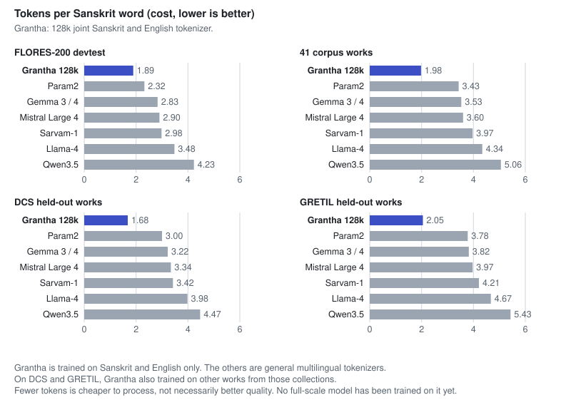

# Grantha Tokenizer

A 128k-vocabulary SentencePiece BPE tokenizer for Sanskrit (Devanagari) and English, built for GranthaLLM.

## Highlights

- **33 to 48% fewer tokens** for Sanskrit than Gemma 3 / 4, and 18 to 46% fewer than Param2, on four benchmarks that include whole works the tokenizer never saw.
- **English is not sacrificed**: 1.17 tokens per word on FLORES, against 1.24 for Gemma 3 / 4.
- **Clean evaluation**: training text excludes [`GranthaLLM/corpus`](https://github.com/GranthaLLM/corpus) and every held-out test work.
- **Ready for a model**: lossless round trip, byte fallback, `<pad>`, chat markers and reserved slots, plus a Hugging Face `tokenizer.json`.

## Quick start

```python
import sentencepiece as spm

sp = spm.SentencePieceProcessor(model_file="release/grantha-128k.model")
ids = sp.encode("कर्मण्येवाधिकारस्ते मा फलेषु कदाचन ।")
assert sp.decode(ids) == "कर्मण्येवाधिकारस्ते मा फलेषु कदाचन ।"
```

With Hugging Face `transformers`:

```python
from transformers import AutoTokenizer

tok = AutoTokenizer.from_pretrained("release/hf")
tok.apply_chat_template([{"role": "user", "content": "अनुवादय"}], add_generation_prompt=True)
```

| id | token | id | token |
|---|---|---|---|
| 0 | `<unk>` | 4 | `<\|im_start\|>` |
| 1 | `<s>` | 5 | `<\|im_end\|>` |
| 2 | `</s>` (end of text) | 6 to 19 | `<\|reserved_0\|>` to `<\|reserved_13\|>` |
| 3 | `<pad>` | | |

Input should be NFC. The Hugging Face tokenizer applies NFC first and returns the same ids as SentencePiece on all 3,036 FLORES Sanskrit, English and Hindi lines.

## Results



Tokens per word, lower is better. This is a cost measure: fewer tokens means cheaper to process and more text per context window. The other tokenizers are general multilingual ones, while Grantha is trained on Sanskrit and English only.

| tokenizer | FLORES Sanskrit | FLORES English | 41 corpus works | DCS held-out | GRETIL held-out |
|---|---|---|---|---|---|
| **Grantha 128k** | **1.90** | **1.17** | **1.99** | **1.68** | **2.05** |
| Param2 | 2.32 | 1.49 | 3.43 | 3.00 | 3.78 |
| Gemma 3 / 4 | 2.83 | 1.24 | 3.53 | 3.22 | 3.82 |
| Mistral Large 4 | 2.90 | 1.27 | 3.60 | 3.34 | 3.97 |
| Sarvam-1 | 2.98 | 1.43 | 3.97 | 3.42 | 4.21 |
| Llama-4 | 3.48 | 1.24 | 4.34 | 3.98 | 4.67 |
| Qwen3.5 | 4.23 | 1.26 | 5.06 | 4.47 | 5.43 |

**Benchmarks**

- **FLORES-200 devtest**: 1,012 modern Sanskrit sentences, with English and Hindi translations.
- **41 corpus works**: the Sanskrit of `corpus/` (1.46M words), used for inference only.
- **DCS and GRETIL held-out works**: 18 DCS and 38 GRETIL works, chosen by hashing the work name and removed from every training source. Text is converted from IAST to Devanagari.

Sanskrit costs 1.26 times the tokens of its English translation, against 1.77 for Gemma 3 / 4. Complete tables: [`fertility_bilingual.md`](results/fertility_bilingual.md) (30+ tokenizers), [`domain_check.md`](results/domain_check.md) (per corpus work) and [`classical_eval.md`](results/classical_eval.md). Kimi K3 (custom tokenizer code), Tiny Aya and Apertus (gated) were not measured. Gemma 4 and Sarvam-30B use the Gemma 3 tokenizer, so one row covers them.

### Example

The opening verse of Madhva's Aitareya Upanishad commentary, from the corpus: ten words, many long compounds.

```
नारायणं निखिलपूर्णगुणैकदेहं सर्वज्ञमच्युतमपेतसमस्तदोषम् ।
प्राणस्य सर्वचिदचित्परमेश्वरस्य साक्षादधीश्वरमियां शरणं रमेशम् ॥
```

| tokenizer | tokens | per word |
|---|---|---|
| **Grantha 128k** | **29** | **2.9** |
| Gemma 3 / 4 | 47 | 4.7 |
| Param2 | 50 | 5.0 |
| Sarvam-1 | 51 | 5.1 |
| Mistral Large 4 | 53 | 5.3 |
| Llama-4 | 62 | 6.2 |
| Qwen3.5 | 72 | 7.2 |

```
Grantha  नारायणं | निखिल | पूर्ण | गुण | ैक | देहं | सर्वज्ञ | म | च्यु | तम | पेत | समस्त | दोषम् | । | प्राणस्य | सर्व | चिद | चि | त्परमे | श्वरस्य | साक्षाद | धी | श्वर | मि | यां | शरणं | रमे | शम् | ॥
Gemma    न | ारा | यण | ं | निखिल | पूर्ण | गुण | ैक | देह | ं | सर्व | ज्ञ | म | च | ्यु | तम | प | ेत | सम | स्त | द | ोष | म् | । ...
```

Grantha keeps words such as `नारायणं`, `निखिल`, `पूर्ण`, `सर्वज्ञ` and `प्राणस्य` whole, where the others break them into letters and bare vowel signs. Very long compounds, such as `सर्वज्ञमच्युतमपेत…`, are still cut in places that do not follow word boundaries.

## Further results

<details>
<summary><b>Compound boundaries</b></summary>

Sandhi and compounds hide where words end, and BPE cuts at frequent letter strings instead. On the 258,707 benchmark compounds below, 73.0% of true boundaries are also token boundaries (F1 0.68, 2.73 tokens per word). Gemma 3 / 4 respects 88.9% (F1 0.50) but needs 5.20 tokens per word, because it cuts everything into small pieces. Param2 respects 58.0% (F1 0.34).

An experimental boundary tagger, kept in `tools/`, raises this to 97.2% respected and F1 0.86 on a 30,000-word sample, at 3 to 12% more tokens. A 91M-parameter GPT trained with it ties with the plain tokenizer within 0.6% bits per byte (one seed), so correct splitting costs no model quality at that scale and no gain was shown. The tagger is not part of the release. Numbers: [`tagged_eval.md`](results/tagged_eval.md) and `results/proxy_*.json`.

</details>

<details>
<summary><b>Resolved-word tokenizer (experimental)</b></summary>

A second design tokenizes the sandhi-resolved words (`स्थिति`, `अप्यय`) and rebuilds the original text with learned join rules (`tools/sandhi.py`, `tools/resolved.py`). Resolution is only accepted when the join reproduces the original word exactly, so the round trip is lossless by construction. With a dictionary of 3M ByT5-Sanskrit labels and no live model:

| set | tokens per word, plain | tokens per word, resolved | word occurrences resolved | exact round trip |
|---|---|---|---|---|
| FLORES Sanskrit | 1.90 | 1.96 | 6.1% | 94.7% |
| DCS held-out | 1.69 | 1.86 | 11.9% | 100.0% |
| GRETIL held-out | 2.06 | 2.27 | 14.8% | 99.8% |

The few inexact round trips differ only in whitespace. The resolved design costs 3 to 10% more tokens and only covers compounds found in the dictionary, since resolving an unseen word needs a model. It is not part of the release.

</details>

<details>
<summary><b>Training variants</b></summary>

| training data | vocab | FLORES Sanskrit | FLORES English | DCS | GRETIL |
|---|---|---|---|---|---|
| web pool + DCS + GRETIL (release) | 128k | 1.90 | 1.17 | 1.68 | 2.05 |
| same, digits not split | 128k | 1.86 | 1.13 | 1.68 | 2.06 |
| web pool + DCS | 128k | 1.87 | 1.16 | 1.71 | 2.15 |
| web pool only | 128k | 1.87 | 1.16 | 1.75 | 2.17 |
| web pool + DCS + GRETIL | 64k | 2.06 | 1.24 | 1.89 | 2.27 |
| web pool only | 64k | 2.05 | 1.23 | 1.97 | 2.38 |

Adding DCS and GRETIL lowers classical fertility by 4 to 6% at no cost elsewhere. The Sanskrit share of the training mix barely matters between 30% and 70% (64k runs), so the final mix is 50/50. Isolating the danda costs 2 to 5% more Sanskrit tokens. Leaving digits unsplit saves 2% of Sanskrit and 3% of English tokens on FLORES, but multi-digit tokens are known to hurt numeric reasoning, so the release splits digits.

</details>

## Benchmark

The held-out material doubles as a benchmark for Sanskrit tokenizers.

| file | contents |
|---|---|
| `benchmark/compounds_test.jsonl.gz` | 258,707 compounds from 18 held-out DCS works. Each item has the word and its boundaries, each boundary a list of acceptable cut positions (sandhi can fuse a vowel into the letter before the cut) |
| `benchmark/unsplit_controls.txt.gz` | 104,863 words DCS does not split |
| `benchmark/heldout_text.parquet`, `heldout_works.json` | Text of the 56 held-out works (18 DCS, 38 GRETIL) and their names |
| `benchmark/compounds_samasa_uoh.jsonl.gz` | 7,429 compounds from the University of Hyderabad samaasa-tagged corpus, split by human annotators. The written word is rebuilt from the tagged components and kept only if it occurs in our corpus |
| `benchmark/compounds_vedanta.jsonl.gz` | 270 long Madhva-style Vedanta words (733 boundaries), split by hand into real words. Vedic mantras with accent marks are left out |

```bash
python tools/score_compounds.py sp:release/grantha-128k.model
python tools/score_compounds.py hf:google/gemma-4-12B-it
```

| tokenizer | precision | recall | F1 | tokens per word |
|---|---|---|---|---|
| Grantha 128k | 0.637 | 0.730 | 0.680 | 2.73 |
| Gemma 3 / 4 | 0.350 | 0.889 | 0.503 | 5.20 |
| Sarvam-1 | 0.341 | 0.886 | 0.492 | 5.34 |
| Mistral Large 4 | 0.230 | 0.656 | 0.340 | 5.64 |
| Param2 | 0.235 | 0.580 | 0.335 | 4.99 |

Recall is the share of true boundaries that are also token boundaries, so a tokenizer can raise it by cutting more. Read it with tokens per word. The gold boundaries come from DCS annotation, which is stronger on epic and Purana text than on philosophical prose. The Vedanta set is not yet human-checked.

## Training data

| part | source | size |
|---|---|---|
| Sanskrit, web | [Sansar](https://huggingface.co/datasets/MuseMesh/sansar-sanskrit-corpus), permissive configs (CC0, CC-BY-4.0, ODC-By, MIT, Apache-2.0); mostly Sangraha and IndicCorp | 2.31M lines, 186.6M words |
| Sanskrit, classical | [DCS](https://github.com/OliverHellwig/sanskrit) (CC BY 4.0) and [GRETIL](https://github.com/INDOLOGY/GRETIL-mirror) (CC BY-NC-SA 4.0), IAST converted to Devanagari | 253 DCS works (3.0M words), 738 GRETIL works (12.5M words) |
| English | Wikipedia (20231101.en, shard 0) and FineWeb-Edu (sample/10BT, shard 0) | 400M characters |

**Preparation.** Unicode NFC, invisible characters stripped, a Devanagari-share filter, exact line deduplication, and removal of every line that shares a 20-character window with `corpus/` or with a held-out work. FLORES overlap with the training text (1 Sanskrit and 123 English lines) was removed.

**Licence.** Wikipedia is CC BY-SA 4.0 and all GRETIL Sanskrit files are CC BY-NC-SA 4.0. This is fine for internal benchmarking and needs a decision before any public release.

## Credits

- [Digital Corpus of Sanskrit](https://github.com/OliverHellwig/sanskrit) (Oliver Hellwig): training text and the held-out test works.
- [Sansar](https://huggingface.co/datasets/MuseMesh/sansar-sanskrit-corpus), which collects [Sangraha](https://huggingface.co/datasets/ai4bharat/sangraha) (AI4Bharat), IndicCorp and others; [GRETIL](https://github.com/INDOLOGY/GRETIL-mirror).
- [FLORES-200](https://github.com/facebookresearch/flores) (Meta) and [SandhiKosh](https://github.com/sanskrit-sandhi/SandhiKosh) (Bhardwaj et al., LREC 2018): evaluation.
- The experimental tagger uses labels from [ByT5-Sanskrit](https://arxiv.org/abs/2409.13920) (Nehrdich, Hellwig and Keutzer, EMNLP Findings 2024).
